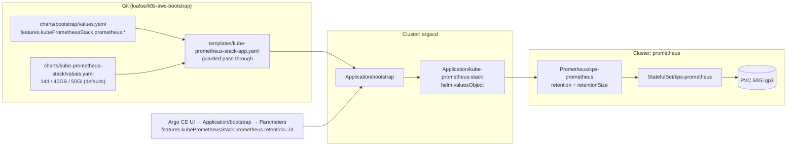

# Explicit Retention Bounds for `kps-prometheus` (14d / 40GB, Argo CD-overridable)

**Date:** 2026-10-29
**Status:** Proposed
**Issue:** CHAR-30
**Author:** Project Architect & Planner

## Context

The `kps-prometheus` StatefulSet crash-looped because its data volume filled up. There is no
size bound on the TSDB today, and the time bound is not something this repository sets — it is
inherited from the upstream chart. The requested end state:

1. Default retention of **14 days**, with a hard **maximum size of 40GB**, whichever is reached
   first — "if possible".
2. The retention period must be **overridable from the Argo CD UI**, the same way the
   `require-image-digest` Kyverno policy is (CHAR-28 / [`optional-policies.md`](../../optional-policies.md)).

This document records the verification findings, the decision, the sizing model that makes
"40GB" achievable at all, and the ordered rollout. It contains no implementation.

## Verification findings

The effective configuration is observable by rendering the chart — the `Prometheus` custom
resource is what the operator acts on, so nothing else matters:

```console
$ helm template kps charts/kube-prometheus-stack -n prometheus \
    | yq 'select(.kind=="Prometheus") | .spec | {retention, retentionSize, retentionPercentage, storage}'
retention: "10d"
retentionSize: null
retentionPercentage: null
storage:
  volumeClaimTemplate:
    spec:
      accessModes:
        - ReadWriteOnce
      resources:
        requests:
          storage: 20Gi
```

| Setting | Source today | Effective value | Assessment |
|---|---|---|---|
| Time retention | **Not in this repo.** `charts/kube-prometheus-stack/values.yaml` never sets it; the value comes from the upstream chart's `prometheusSpec.retention` default (`kube-prometheus-stack` 92.14.1, vendored `values.yaml`) | `10d` | Wrong number (asked for 14d) **and** silently owned by a dependency that Renovate bumps several times a month |
| Size retention | Not set anywhere | unset → **disabled** | The only bound on disk usage is the filesystem itself, which is to say: none. This is the direct cause of the disk-full crash |
| Percentage retention | Not set anywhere | unset | n/a |
| Volume | `storageSpec.volumeClaimTemplate` (20Gi, cluster-default `gp3-encrypted`) | `20Gi` | Too small for any size-bounded configuration, see below |
| Alertmanager retention | Upstream chart default | `120h` | Out of scope, noted so it is not mistaken for the Prometheus setting |

Two things worth stating plainly:

- **We are relying on a dependency's default, which is worse than relying on Prometheus's
  default.** Prometheus's own default would be `15d`; the chart overrides it to `10d`. Neither
  is 14d, and because Renovate bumps this chart automatically (PR #301 was exactly that), the
  number can change without a commit in this repository.
- **The crash was not "retention too long", it was "no size bound".** Prometheus deletes whole
  persisted blocks to honour a size limit; with the limit unset, filling the volume is the
  expected outcome, and the failure mode is `ENOSPC` (crash / failed WAL replay), not
  "oldest data dropped".

Live cluster state (CR, StatefulSet, PVC, actual `du`) is unverified — the SSO token for the
EKS contexts was expired when this was written. The pre-flight commands that close that gap are
in the delivery plan; the rendered values above are conclusive for what the chart asks for.

## Sizing: why 40GB needs a bigger volume

Prometheus documents the rules this design has to respect
([storage docs](https://prometheus.io/docs/prometheus/latest/storage/)):

- When both time and size retention are set, **whichever triggers first wins** — exactly the
  requested semantics.
- Only *persisted blocks* are deleted for `retention.size`. The WAL and `chunks_head` are
  counted in the size but are not deletable, so the volume must additionally hold their peak.
- Compaction keeps the source blocks **and** the new compacted block on disk simultaneously, so
  usage transiently **exceeds** `retention.size`.
- Therefore: *"set the retention size to at most 80–85% of your allocated Prometheus disk
  space."*
- Units are powers of two, so `40GB` = 40 GiB = 42.9e9 bytes.

That last rule decides the volume size:

| Volume | Max size cap at 80–85% | Does a 40GB cap work? |
|---|---|---|
| 20Gi (today) | 16–17GiB | **No.** The volume fills before the cap is ever reachable |
| 40Gi | 32–34GiB | No — cap is above the safety line |
| **50Gi** | **40–42.5GiB** | **Yes — 40GB is exactly 80%**, the maximum Prometheus recommends |

Cost of the change is a 30Gi increase on a gp3 volume (order of a dollar or two a month) and it
is an **online** EBS expansion (`allowVolumeExpansion: true` is already set on
`gp3-encrypted`).

Estimated footprint at the target retention, from the one measurement we have — the crash
itself, i.e. the 10-day working set plus compaction overhead did not fit in 20GiB, so
≈2GiB/day of persisted blocks:

| Bound | Value | Binds? |
|---|---|---|
| Time: 14 days at ~2GiB/day | ~28GiB of blocks | **Binding** (reached first) |
| Size: 40GB cap | 40GiB | Safety net, never reached at current ingest |
| Volume with 15–20% compaction headroom | 50Gi | 28GiB is 56% — comfortable |

Consequence worth stating explicitly for the operator: **the size cap makes retention increases
safe**. Raising the period to 30d from the UI cannot fill the disk — the 40GB cap starts
dropping the oldest blocks instead. That is the property this design buys, and it is the reason
the cap is not merely a second knob but the actual guarantee.

Caveat: if ingest roughly doubles, 14 days will exceed 40GiB, the cap binds first, and effective
retention silently drops below 14d (that is the requested "whichever is reached first"
behaviour, but it must not be a surprise). The cap protects the disk; it does not protect the
retention promise.

## Decision

### Value contract

**Single source of truth for the defaults** is the wrapper chart, because that is what every
cluster running this chart inherits and what a chart-only deployment gets:

`charts/kube-prometheus-stack/values.yaml`

```yaml
kube-prometheus-stack:
  prometheus:
    prometheusSpec:
      # Time and size retention. Prometheus applies whichever is reached first.
      retention: "14d"
      retentionSize: "40GB"
      storageSpec:
        volumeClaimTemplate:
          spec:
            resources:
              requests:
                storage: 50Gi
```

**Override surface** is the bootstrap chart, mirroring the Kyverno pattern, so a cluster can be
changed from the Argo CD UI without a commit:

`charts/bootstrap/values.yaml`

```yaml
features:
  kubePrometheusStack:
    enabled: true
    grafana:
      enabled: false
    # Empty = use the kube-prometheus-stack chart defaults (14d / 40GB / 50Gi).
    # Set any of these to override per cluster from the Argo CD UI.
    prometheus:
      retention: ""
      retentionSize: ""
      storageSize: ""
```

`charts/bootstrap/templates/kube-prometheus-stack/kube-prometheus-stack-app.yaml` passes each
value through into the child Application's `valuesObject` **only when non-empty**.

### The empty-string trap (this is the one that bites)

The upstream template renders `prometheusSpec.retention` **unconditionally**:

```yaml
retention: {{ .Values.prometheus.prometheusSpec.retention | quote }}
```

so passing `retention: ""` from the bootstrap app would *override* the wrapper's `14d` with an
empty string. What the operator then does with an empty `spec.retention` is decided by
`RetentionTimeOrDefault` (prometheus-operator, `pkg/prometheus/common.go`):

| `spec.retention` | `spec.retentionSize` | Effective result |
|---|---|---|
| `""` | unset | **`24h`** (`DefaultRetention`) — 13 days of history deleted on the next compaction, and the dashboard looks healthy |
| `""` | `40GB` | **no time bound at all** — only the size cap applies |
| `"14d"` | `40GB` | intended |

A naive pass-through therefore silently turns the requested 14 days into one day (or removes the
time bound entirely). Every pass-through must be guarded (Helm `with`), and the acceptance
criteria below include a render test that proves no empty value reaches the `Prometheus`
resource.

### Where the value is actually enforced (matters for verification)

This cluster runs Prometheus **v3.15.1** (KPS 92.14.1). Since v3.11 the operator no longer passes
`--storage.tsdb.retention.*` on the command line — it writes the retention block into the
generated Prometheus **config file** (`pkg/prometheus/promcfg.go`, `appendStorageSettingsConfig`).
Two consequences:

- Verifying by grepping the StatefulSet's container args proves nothing. Verify `Prometheus.spec`
  (the operator's input) and the rendered config Secret (grep `retention:` under `storage.tsdb`).
- No pod restart is needed for a retention change: `DB.ApplyConfig` re-reads the retention block
  and the config-reloader triggers a reload of the running server
  (Prometheus `tsdb/db.go`, `ApplyConfig`).

### Behaviour matrix

| `features.kubePrometheusStack.prometheus.retention` | Effective time bound | Size bound | Result |
|---|---|---|---|
| unset (default) | 14d (chart) | 40GB (chart) | ~28GiB of blocks on a 50Gi volume; 14d binds first |
| `7d` | 7d | 40GB | 7d binds first; ~14GiB used |
| `30d` | 30d | 40GB (binds at ~20d) | Disk stays safe; history capped by the size limit |
| unset, but `retentionSize: 80GB` | 14d | 80GB | **Fails the 80% rule on a 50Gi volume** — `storageSize` must be raised in the same change |

### Override path



Two override surfaces, deliberately:

| Surface | Persistence | Use it for |
|---|---|---|
| Helm parameter on `Application/bootstrap` (writes `spec.source.helm.parameters`) | In the Application object; survives restarts, but is drift relative to the IaC that creates the Application (Pulumi/SSM) and can be reconciled away by a re-provisioning `pulumi up` | Changing one cluster's retention right now |
| `charts/bootstrap/values.yaml` (or the Pulumi/SSM values that feed it) | Durable, reviewed, declarative | Making the choice permanent |

**Editing `Application/kube-prometheus-stack` directly is not a supported surface.** It is a
child of `Application/bootstrap` with `selfHeal: true`; any hand edit is reverted on the next
reconcile. Only the `bootstrap` parameters reach it durably.

## Options considered

| Option | Description | Verdict |
|---|---|---|
| **A. Explicit values in the wrapper chart + guarded pass-through in bootstrap** | Defaults live in `charts/kube-prometheus-stack/values.yaml`; bootstrap exposes three leaf strings for per-cluster override | **Chosen.** Matches the Kyverno precedent, keeps one source of truth for defaults, and makes the whole thing `--set`-able (which is what the Argo CD parameter model needs) |
| B. Only set values in the wrapper chart | Hardcode 14d/40GB, no bootstrap plumbing | Rejected — no Argo CD override, which is half the request |
| C. Only expose through bootstrap, no chart default | Every cluster must be told its retention | Rejected — a cluster that renders the chart directly would fall back to the upstream `10d`, i.e. the bug this issue is about |
| D. Expose `retentionPercentage` instead of `retentionSize` | Prometheus ≥ 3.11 caps by percentage of volume | Rejected as the primary knob, **and it cannot be combined**: if the percentage is set, Prometheus *ignores* `retention.size` (warns: *"storage.tsdb.retention.size is ignored, because storage.tsdb.retention.percentage is specified"*, v3.15.1). It also silently changes retention whenever the PVC is resized. Documented as the alternative for clusters that will never resize their volume |
| E. Edit the `Prometheus` CR / Application in-cluster | `kubectl patch` the retention | Rejected as durable state — reverted by `selfHeal`; acceptable only as a stop-gap, and pointless here because the chart change is small |
| F. Drop metrics / cut ingest instead of sizing the volume | Reduce series count or lengthen scrape intervals | Out of scope for this issue, but the real long-term lever: it lowers the cost of the 14d promise. Worth a separate issue if the 40GB cap starts binding |

## Delivery plan

### P0 — stop the bleeding, before any chart change ships

Expand the live PVC to **50Gi** and wait for `status.capacity` to catch up:

```bash
kubectl -n prometheus patch pvc prometheus-kps-prometheus-db-prometheus-kps-prometheus-0 \
  -p '{"spec":{"resources":{"requests":{"storage":"50Gi"}}}}'
kubectl -n prometheus get pvc -w     # capacity 50Gi; fs resize completes on the running pod
```

Online, a minute of EBS work, the state the chart will converge to anyway, and it removes the
recurrence risk immediately. No Git change, no pod restart.

### P1 — make it explicit and overridable (one chart change)

| # | Task | Acceptance |
|---|---|---|
| 1 | Pre-flight measurement on the cluster (SSO refresh required) | Recorded values for `spec.retention`/`retentionSize`, the PVC size, `df -h /prometheus`, `du -sh /prometheus/{blocks,wal,chunks_head}` and `prometheus_tsdb_head_series`. Confirms the ~2GiB/day assumption; if it is materially higher, re-derive the cap/volume pair before proceeding |
| 2 | Wrapper chart: `retention: "14d"`, `retentionSize: "40GB"`, PVC `50Gi`, with a comment block stating the 80% rule and why 40GB fits only on ≥50Gi | `helm template kps charts/kube-prometheus-stack` shows all three values |
| 3 | Bootstrap chart: `features.kubePrometheusStack.prometheus.{retention,retentionSize,storageSize}` defaulting to `""` | Values render as empty and change nothing |
| 4 | Bootstrap template: guarded (`with`) pass-through of the three keys into the child Application's `valuesObject`, nested under `kube-prometheus-stack.prometheus.prometheusSpec` / `storageSpec` | Default render is **byte-identical** to `origin/main`; with `--set features.kubePrometheusStack.prometheus.retention=7d` the child Application's `valuesObject` carries exactly that, and never `retention: ""` |
| 5 | Bump both touched charts (`./scripts/bump-chart-version.sh charts/bootstrap charts/kube-prometheus-stack`) | `./scripts/check-chart-version-bump.sh` passes |
| 6 | Operator runbook `docs/prometheus-retention.md` + link from root `README.md` | UI path (Parameters panel, YAML-editor equivalent), verification (`kubectl get prometheus … -o jsonpath`), revert path, the `pulumi up` drift caveat, and the merge-safe `kubectl patch` fallback (JSON Patch `add` on `/spec/source/helm/parameters` replaces the whole list) |
| 7 | Refresh `charts/bootstrap/README.md` values table (`helm-docs`) | New keys documented |
| 8 | Operator runbook notes that retention is read from the config file on this Prometheus version, so it is verified via the CR and the rendered config Secret — not via the StatefulSet's args | Runbook contains both verification commands |

### P2 — converge the live StatefulSet (this is the risky step)

The volume size lives in `Prometheus.spec.storage.volumeClaimTemplate`, which
prometheus-operator copies into `StatefulSet.spec.volumeClaimTemplates` — an **immutable**
field. Changing it in the chart will make the operator's update fail until the StatefulSet is
recreated:

```bash
kubectl -n prometheus delete statefulset kps-prometheus --cascade=orphan
# operator recreates it with the 50Gi template; the running pod is adopted, not killed
kubectl -n prometheus rollout status statefulset/kps-prometheus
```

Prerequisite: step P0 already grew the PVC, so the recreated StatefulSet adopts a claim that is
already 50Gi. Doing it the other way round (chart first, PVC later) leaves a window where the
template says 50Gi and the claim says 20Gi, and the operator will keep failing that update.

### P3 — verify and record

```bash
kubectl -n prometheus get prometheus kps-prometheus \
  -o jsonpath='{.spec.retention} {.spec.retentionSize}{"\n"}'        # 14d 40GB
# the operator's input is not what Prometheus reads: check the rendered config too
kubectl -n prometheus get secret prometheus-kps-prometheus \
  -o jsonpath='{.data.prometheus\.yaml\.gz}' | base64 -d | gunzip | grep -A4 'retention:'
kubectl -n prometheus get sts kps-prometheus \
  -o jsonpath='{.spec.volumeClaimTemplates[0].spec.resources.requests.storage}{"\n"}'   # 50Gi
kubectl -n prometheus get pvc -l app.kubernetes.io/name=prometheus   # capacity 50Gi, no pending resize
kubectl -n prometheus exec sts/kps-prometheus -c prometheus -- df -h /prometheus
```

Steady state to watch for a week: `df -h /prometheus` under 85%,
`prometheus_tsdb_storage_blocks_bytes` staying below 40GB, and the oldest block's age reaching
~14 days (`prometheus_tsdb_lowest_timestamp` against `time()`), which is the promise itself and
is not otherwise visible on any dashboard.

## Rollout, rollback, and the failure modes that matter

**Rollback** is a values revert plus one more StatefulSet orphan-recreate if the volume size is
reverted too (PVCs cannot shrink). Prefer *not* reverting the volume: 50Gi with a 40GB cap is
safe at any retention.

| Risk | Impact | Mitigation |
|---|---|---|
| Empty pass-through reaching the `Prometheus` CR | `retention: ""` → operator default `24h` (or, if the size cap is set, no time bound at all); 13 days of history deleted on the next compaction, silently | Guarded (`with`) pass-through + the render test in acceptance #4; the runbook verification command checks the CR, not the chart |
| Chart change applied before the PVC is expanded | Operator cannot update the immutable `volumeClaimTemplates`; recurring reconcile errors; chart says 50Gi, claim says 20Gi | P0 before P1; the orphan-delete documented as an explicit step, not a surprise |
| StatefulSet recreate does not adopt the pod | Brief metrics gap while the pod is recreated and replays the WAL (the failure that caused the earlier OOM loop) | `--cascade=orphan` never deletes the pod; if it must be recreated, the 3Gi memory limit and the persisted WAL make replay survivable (commit `e1019b7`). Do it in a quiet window |
| Ingest growth pushes 14d past 40GiB | Effective retention drops below 14d; nobody notices until an incident review asks for old data | The cap is what keeps the disk safe; alert on oldest-block-age vs 14d (or on `prometheus_tsdb_storage_blocks_bytes` approaching 40GB) so the promise is measured, not assumed |
| Renovate bumps the chart and changes an upstream default again | The default silently moves under us a second time | After this change the values are explicit in this repo, so upstream defaults no longer govern. Worth a `helm template` diff in review for any `kube-prometheus-stack` bump that touches `retention*` |
| Someone raises the cap to 80GB without raising the PVC | Returns to the original disk-full failure, with a misleading config | The runbook states the invariant "cap ≤ 80% of volume"; the pair is changed together or not at all |
| Alertmanager retention still upstream-owned | Same class of hidden dependency, different binary | Out of scope; noted so it is a conscious omission |

## Assumptions & open questions

- **Assumed:** `Application/bootstrap` is created outside this repo (Pulumi → SSM → user-data),
  so its Helm values are UI-editable without a Git change. If it ever becomes self-managed from
  Git, the UI path stops working and the runbook must point at the values instead.
- **Assumed:** the ~2GiB/day ingest figure implied by the crash. It is the only evidence
  available offline and drives nothing that is not re-checked in pre-flight; if the real number
  is higher, the 40GB cap binds before 14d and the operator must choose between a longer period
  (bigger volume) or the cap.
- **Open:** the crash happened with 20Gi and a nominal 10-day retention, which mathematically
  should have fit. If the pre-flight `du` shows the blocks well under 20GiB, the space went to
  WAL/`chunks_head` (e.g. WAL that never drained because of restarts) rather than to data, and
  the size cap alone may not have prevented it — worth understanding before declaring the
  incident closed, because it would point at a second, independent failure mode.
- **Open:** whether other clusters should get the same explicit treatment. The wrapper chart is
  currently tuned for one cluster (`dip-ce-k3s-eu`); `ci-obs-euw1` runs its own values with an
  `io1` storage class and may want a different cap/volume pair.
- **Follow-up (not this issue):** a `retentionPercentage`-based mode for clusters that resize
  their volumes often, and an alert on the retention promise (oldest block age), since a size
  cap silently trades retention for disk safety.
