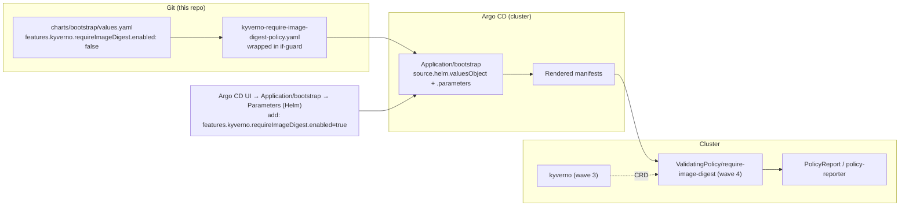

# Making `require-image-digest` an Opt-In Kyverno Policy

**Date:** 2026-10-29
**Status:** Proposed
**Issue:** CHAR-28
**Author:** Project Architect & Planner

## Context

`require-image-digest` was added in CHAR-18 (commit `d008fbc`) as one of seven CEL-based
Zero Trust `ValidatingPolicy` resources that the bootstrap chart renders unconditionally.
It requires every Pod container image to be pinned by `@sha256:` digest.

In practice almost every upstream image this chart deploys is pinned by tag
(`alpine/k8s:1.35.0`, `kube-prometheus-stack`, `cilium`, …), so on a freshly bootstrapped
cluster the policy is a permanent source of `PolicyReport` noise: it flags the platform's own
workloads and would block them outright the moment anyone set `validationActions: Deny`.
It cannot simply be deleted either — it is the guardrail that makes workloads reproducible on
clusters that *can* satisfy it (typically once images are mirrored/pinned by the platform team).

The decision this document records: **the policy becomes an opt-in, chart-level feature flag,
off by default, that an operator can switch on per cluster from the Argo CD bootstrap
application — without editing Git.**

## Decision

Introduce a feature namespace on the bootstrap chart:

```yaml
features:
  kyverno:
    # Optional Kyverno guardrails, off by default. Enable per cluster.
    requireImageDigest:
      enabled: false   # default
```

`charts/bootstrap/templates/kyverno/kyverno-require-image-digest-policy.yaml` is rendered only
when that value is `true`. Nothing else about the policy changes — same name, same
`Audit`-only `validationActions`, same `matchingConstraints`, same sync-wave annotations — so
enabling it is a pure add of one object and disabling it is a clean prune.

### Behavior matrix

| `features.kyverno.requireImageDigest.enabled` | Rendered objects | Operator-visible effect |
|---|---|---|
| `false` (default) | none | No `ValidatingPolicy`, no `PolicyReport`s, zero admission cost. Equivalent to the pre-CHAR-18 cluster. |
| `true` | `ValidatingPolicy/require-image-digest` | Background scan + admission *audit* reports; nothing is ever denied (`validationActions: [Audit]`). |

### Override surface

The flag is a **plain, `--set`-able leaf value** — deliberately, because that is what makes it
addressable from the Argo CD Application parameter model (`spec.source.helm.parameters`), not
only from a Git-tracked `values.yaml`. That property, not the YAML shape, is the actual
requirement behind "overridable at the Argo CD level".



Two override surfaces exist, by design:

| Surface | Persistence | Use it for |
|---|---|---|
| Argo CD UI parameter on `Application/bootstrap` (writes `spec.source.helm.parameters`) | Lives in the Application object; survives cluster/Argo restarts, but is **drift** relative to the IaC that creates the Application (Pulumi/SSM) and can be reconciled away by a re-provisioning `pulumi up` | Flipping the policy on/off for one cluster right now; evaluating the reports |
| Chart values in the `bootstrap` chart (Pulumi values / SSM env config / a values overlay) | Durable, declarative, reviewed | Making the choice permanent for that cluster |

## Options considered

| Option | Description | Verdict |
|---|---|---|
| **A. Chart feature flag, policy not rendered when off** | `features.kyverno.requireImageDigest.enabled: false`; if-guard around the policy template | **Chosen.** Matches the repo's existing feature-flag idiom (`descheduler`, `spiffe`, `gatewayApi`); disabled really means *absent* — no reports, no cost, nothing to reason about. |
| B. Always render, make enforcement configurable | Keep the object, expose `validationActions` (`Audit` \| `Deny`) | Rejected as the primary knob. "Disabled" would still mean reports and a policy object to explain; not what was asked for. Worth adding *later* as a second knob (see Follow-ups). |
| C. `PolicyException` per cluster | Ship the policy on, exempt workloads by exception | Rejected. Inverts the effort: every new workload needs a waiver, and `govern-policy-exceptions` (CHAR-20) then requires a TTL label, ticket, owner and compensating-controls annotations for each. |
| D. Separate chart / Argo CD Application for optional policies | Package optional guardrails as their own app | Rejected for one policy — a second Application plus sync-wave ordering for no benefit. Revisit if the optional-policy set grows past ~3. |
| E. Delete the policy | — | Rejected. Loses a guardrail the user explicitly wants available per cluster. |

Option A also keeps the blast radius of this change to: one template guard, one values block,
one chart version bump, docs.

## Enablement runbook (Argo CD UI)

Preconditions: the release containing this change is what `Application/bootstrap` tracks, the
Kyverno app is `Synced`/`Healthy` (it owns the `policies.kyverno.io/v1` CRDs), and you are
logged into the Argo CD UI with permission to edit the `bootstrap` application.

**Enable**

1. Open the Argo CD UI and select the **`bootstrap`** application (namespace `argocd`).
2. Open its **Parameters** panel (Helm parameters), or use **Edit → Application YAML** if your
   Argo CD version only exposes parameters read-only.
3. Add a Helm parameter:

   | Name | Value |
   |---|---|
   | `features.kyverno.requireImageDigest.enabled` | `true` |

   YAML-editor equivalent — merge into `spec.source.helm.valuesObject`:

   ```yaml
   features:
     kyverno:
       requireImageDigest:
         enabled: true
   ```

4. Save, then **Sync** the `bootstrap` application (auto-sync off ⇒ this click is required).
   The policy is `sync-wave: "4"`, i.e. it is applied a few seconds after the other bootstrap
   resources; a transient `no matches for kind "ValidatingPolicy"` on that one manifest is
   already absorbed by its `SkipDryRunOnMissingResource=true` annotation.
5. Verify:

   ```bash
   kubectl get validatingpolicy require-image-digest
   kubectl get policyreport -A | head        # reports appear within one scan cycle
   ```

   Absence of the object before enabling (and after disabling) is the expected, correct state.

**Disable again**

Remove the parameter (or set it to `false`) and sync. Argo CD prunes the
`ValidatingPolicy`; existing reports age out through policy-reporter's retention.

**CLI fallback** (the repository notes the `argocd` CLI is broken behind the Cilium gateway —
`docs/argocd-cli-grpc-cilium-gateway.md` — so prefer the UI or `kubectl`):

```bash
kubectl -n argocd patch application bootstrap --type=json -p \
  '[{"op":"add","path":"/spec/source/helm/parameters","value":[{"name":"features.kyverno.requireImageDigest.enabled","value":"true"}]}]'
```

(`add` on `/spec/source/helm/parameters` replaces any existing parameter list — the UI path
avoids that footgun.)

## Risks & mitigations

| Risk | Impact | Mitigation |
|---|---|---|
| A UI parameter is drift from the IaC that creates `Application/bootstrap`; the next `pulumi up` may drop it | Policy silently disappears/changes after re-provisioning | Runbook states it explicitly; promote any lasting choice into the Pulumi/SSM bootstrap values |
| Gating a policy file with Go templating breaks a future `kyverno test` fixture — the CI harness (`tests/policies/`) feeds raw template files to the Kyverno CLI, so a guarded file no longer parses | A contributor adding a fixture gets a confusing red CI run | No fixture exists for this policy today; the plan records the constraint: either test through a rendered manifest or accept no fixture, as now |
| Operator enables `Deny` by editing the policy in-cluster | Pruned back on next sync (self-heal), or worse, drift | Documented: `validationActions` is owned by the chart; a second knob is the follow-up path |
| Enabled on a cluster whose platform images are tag-pinned | Large `PolicyReport` volume in policy-reporter | Audit-only, reports are informational; follow-up knob for enforcement |
| `features.kyverno` omitted from a hand-maintained values overlay | Helm merges chart defaults, so the policy stays off — fail-safe direction | Fail-safe by construction; the guard reads `false` unless explicitly set |

## Rollout & rollback

- **Rollout:** chart version bump (required by `Chart Version Check`), release, then nothing
  changes on any cluster until someone opts in — the expected diff on every existing cluster is
  the *removal* of one `ValidatingPolicy`.
- **Rollback:** revert the chart version / set the flag back to `false`. Both are non-destructive;
  the object is pruned, no workload state is involved.
- **Communication:** clusters currently getting the policy will lose it. That is the requested
  behavior, and the release notes should say so.

## Delivery plan

| # | Task | Acceptance |
|---|---|---|
| 1 | Add `features.kyverno.requireImageDigest.enabled: false` to `charts/bootstrap/values.yaml` | Key present, documented with a comment, default `false` |
| 2 | Wrap the policy template in an if-guard on that value | `helm template … ` emits 0 `require-image-digest` objects by default, exactly 1 with `--set features.kyverno.requireImageDigest.enabled=true`; `helm lint` clean in both |
| 3 | Bump `charts/bootstrap` (patch) via `scripts/bump-chart-version.sh` | `Chart Version Check` green |
| 4 | Document: `docs/optional-policies.md` with the runbook above, linked from the root `README.md` | Operator can follow the UI path without reading the chart |
| 5 | Regenerate `charts/bootstrap/README.md` values table (`helm-docs`) if the tool is available | New value appears in the table; if `helm-docs` is unavailable, add the row by hand |

Out of scope / follow-ups: a `validationActions` knob (Audit vs Deny) exposed the same way; the
same opt-in treatment for the other CEL policies where they prove noisy; promoting the chosen
value into the Pulumi/SSM bootstrap config for clusters that adopt it.

## Assumptions & open questions

- **Assumed:** `Application/bootstrap` is created outside this repository (Pulumi → SSM →
  master user-data) and therefore its Helm values are UI-editable without a Git change. If it
  ever becomes self-managed by Argo CD from Git, the UI path stops working and the runbook must
  be replaced by a values change in the IaC repository.
- **Open:** should the value live under `features.kyverno.policies.*` to leave room for more
  optional policies? Deferred — a flat, greppable key is friendlier for hand-typed UI
  parameters, and renaming later is a values-only change.
- **Open:** is `Audit` the right default action the day someone flips it on, or should enabling
  also offer `Deny` in the same edit? Deferred to the follow-up knob.
